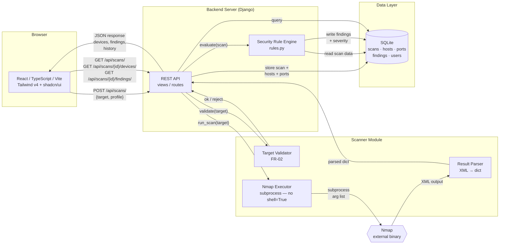

# NetSecure — Architecture

## System Boundaries and Data Flow

The diagram below shows how a scan request moves through the system, from user
action to dashboard display. Each box is a deployable component with a distinct
responsibility. Arrows show the primary data flow direction.



## Component Responsibilities

| Component | Directory | Key Files (planned) | SRS Coverage |
|-----------|-----------|---------------------|--------------|
| **Frontend** | `frontend/` | `src/routes.tsx`, `src/layouts/`, `src/pages/`, `src/components/`, `src/api/client.ts` | FR-04, FR-06 (display), NFR-02, NFR-03 |
| **Backend API** | `backend/` | `config/settings.py`, `config/urls.py`, `api/views.py`, `api/urls.py` | FR-01 (invoke), FR-03 (store), FR-05 (warnings) |
| **Scanner** | `scanner/` | `scanner.py`, `validator.py` | FR-01 (Nmap), FR-02 (validation) |
| **Database** | `database/`, `backend/api/` | `database/schema.sql` + `*.sql` (reference design); `api/models.py`, `api/migrations/`, `api/scan_store.py` (what runs) | FR-03 (persistence), NFR-04 (failure logs) |
| **Rule Engine** | `backend/` | `rules.py` | FR-05 (warnings), FR-06 (severity) |

## Current Repo State

As of initial scaffold:

- **`frontend/`** — Dashboard shell: sidebar layout with React Router routes for
  New Scan, Devices, Findings, and History. New Scan calls `POST /api/scans/`,
  History lists `GET /api/scans/` and links each completed scan to its devices
  and findings. Devices and Findings show `GET /api/scans/{id}/devices/` and
  `/findings/` for the scan in `?scan=<id>` or, without it, the newest completed
  scan (shared `useSelectedScan` hook). Findings stays empty until the rule engine
  stores findings (WBS 7.0). Vite
  proxies `/api` to Django in development; the header shows backend health from
  `GET /api/health/`. Tests run with Vitest + React Testing Library.
- **`backend/`** — Django 6.1 project initialized (`config/` project package,
  `api/` app). Settings read from environment variables. Routes are listed under
  API Endpoints below. All `/api/` errors return JSON (see API Error Format below).
  Scan-target validation is a fail-closed placeholder until the scanner's
  validator exists.
- **`scanner/`** — Empty (`.gitkeep`). Scanner module not yet created.
- **`database/`** — Matt's SQLite schema (`schema.sql`) and dashboard queries.
  Django migrations own the live schema (`backend/api/models.py`); scans are
  saved through `backend/api/scan_store.py`. See `database/README.md`.
- **`docs/`** — SRS and Project Plan present. Design doc, roadmap, and this file
  added as part of repo setup.

## Interface Contracts (to be defined in WBS 2.0)

These interfaces connect the components. Exact shapes will be agreed during the
Architecture and Interfaces phase (Sep 16–27).

| Interface | From → To | Format |
|-----------|-----------|--------|
| Scan request | Frontend → Backend | `POST /api/scan` — JSON `{ target: string }` |
| Scan result | Scanner → Backend | Python dict: `{ hosts: [{ ip, hostname, ports: [{ number, protocol, service, state }] }] }` |
| Findings | Rule Engine → Database | Finding rows: `{ scan_id, host_ip, port, service, severity, description }` |
| Dashboard data | Backend → Frontend | JSON — see API Endpoints below |
| API errors | Backend → Frontend | JSON — see API Error Format below |

## API Endpoints

All under `/api/`, implemented in `backend/api/views.py`. Timestamps are ISO 8601
UTC (`2026-11-02T01:00:00Z`). The browser protects dashboard routes with the
session login flow (see Authentication below). The scan endpoints still don't
require a logged-in session or restrict scans by owner; backend access control
is the remaining WBS 9.0 item.

| Method + path | Returns |
|---------------|---------|
| `GET /api/health/` | `{ status: "ok" }` |
| `GET /api/csrf/` | `{ csrfToken }`, and sets the CSRF cookie POSTs need |
| `POST /api/auth/login/` | Body `{ username, password }`. Starts a session. `{ user: { id, username }, csrfToken }`; 400 `validation_error` for a missing/blank field, 401 `invalid_credentials`, 429 `too_many_login_attempts` after repeated failures |
| `POST /api/auth/logout/` | Ends the session. 204, logged in or not |
| `GET /api/auth/me/` | `{ user: { id, username } }`; 401 `not_authenticated` |
| `POST /api/scans/` | Body `{ target, profile? }`. Runs the scan synchronously and saves it. `{ scan_id, target, profile, hosts }`; 400 invalid input, 502 scan failed (still saved as failed) |
| `GET /api/scans/` | `{ scans: [{ scan_id, target, profile, timestamp, finished_at, status, error_message, devices_found, findings_found }] }`, newest first. `timestamp` is the start time; `status` is `Pending` / `In-Progress` / `Completed` / `Failed` |
| `GET /api/scans/{id}/devices/` | `{ scan_id, devices: [{ host_id, ip_address, hostname, service_id, port, protocol, service, product, version }] }`, one row per open service; a host with none has one row with null service fields. 404 `scan_not_found` |
| `GET /api/scans/{id}/findings/` | `{ scan_id, findings: [{ finding_id, severity, finding, host, port, protocol, service, description }] }`, most severe first. 404 `scan_not_found` |

The history/devices/findings rows match `database/history_results.sql`,
`service_results.sql`, and `finding_results.sql` (via `api/scan_store.py`).

## Authentication

Login uses Django's session authentication (WBS 9.0, UC-01), implemented in
`backend/api/auth_views.py`. There is no sign-up: an administrator creates
accounts with `python manage.py createsuperuser` or the Django admin.

- The session ID is in an HTTP-only, `SameSite=Lax` cookie that lasts 8 hours.
  Session and CSRF cookies are HTTPS-only when `DJANGO_DEBUG` is off, unless
  `DJANGO_SECURE_COOKIES=0` (plain-HTTP lab server).
- Login and logout are CSRF-protected like every other POST: fetch
  `/api/csrf/` first and send `X-CSRFToken`.
- **Login rotates the CSRF token.** The frontend must replace its cached token
  with the `csrfToken` from the login response, or its next POST fails with 403.
- Passwords are checked exactly as typed (no whitespace trimming); usernames
  are trimmed.
- Repeated failed logins are throttled (`backend/api/login_throttle.py`): 5
  failures for one username from one IP, or 20 from one IP across all
  usernames, within 15 minutes of the first failure. Past either limit, login
  returns 429 with `Retry-After` until that window ends, even with the right
  password. A successful login clears the username + IP count. Limits are the
  `LOGIN_THROTTLE_*` settings. Counts live in Django's in-memory cache, so each
  server process keeps its own and a restart clears them. The client IP is
  `REMOTE_ADDR`; behind a reverse proxy all clients would share one count.
- The frontend loads the session user once through `GET /api/auth/me/` before
  rendering dashboard routes. Logged-out users go to `/login` and return to
  their requested path after signing in. Logged-in users opening `/login` return
  to the dashboard.
- Dashboard navigation includes logout. A successful logout accepts the API's
  empty 204 response and clears the cached CSRF token so the next POST fetches a
  fresh one. A 401 from another API request clears frontend auth state and
  redirects to `/login`.
- The browser checks are for the user interface only; the backend enforces
  access on its own.

### Scan authorization

Every scan endpoint (`POST`/`GET /api/scans/` and the per-scan devices and
findings) requires a session and returns 401 without one. New scans belong to
the user who started them, and users only see their own scans. Ownership is
enforced in `scan_store`: the history, devices and findings queries require the
user and filter by owner. A missing scan and another user's scan return the
same 404. Older scans with no owner are kept in the database but hidden. See
`SCAN_AUTHORIZATION.md` before deploying.

## API Error Format

Every error response under `/api/` uses the same JSON shape, whatever the
cause (bad input, unknown URL, wrong method, CSRF failure, server error):

```json
{ "error": { "code": "validation_error", "message": "\"target\" is required.", "details": { "field": "target" } } }
```

- `code` — stable, machine-readable string; branch on this in the frontend.
- `message` — human-readable text, safe to show the user.
- `details` — optional; for field errors, `field` names the request field.

| Status | `code` | When |
|--------|--------|------|
| 400 | `invalid_json` | Body is not valid JSON, or not a JSON object |
| 400 | `validation_error` | A field is missing, the wrong type, blank, or too long |
| 400 | `invalid_target` | Scanner validator rejected the target (FR-02) — available once the scanner is integrated |
| 400 | `bad_request` | Other malformed request |
| 401 | `invalid_credentials` | Login with a wrong username or password, or an inactive account (one message for all) |
| 401 | `not_authenticated` | `GET /api/auth/me/` without a logged-in session |
| 403 | `forbidden` | Permission denied or CSRF check failed |
| 404 | `not_found` | Unknown URL or missing resource |
| 405 | `method_not_allowed` | Wrong HTTP method (`Allow` header lists valid ones) |
| 413 | `payload_too_large` | Body exceeds Django's upload size limit |
| 415 | `unsupported_media_type` | Body sent without `Content-Type: application/json` |
| 429 | `too_many_login_attempts` | Too many failed logins; `Retry-After` gives the seconds to wait |
| 500 | `internal_error` | Unexpected server error (details are logged, never returned) |
| 503 | `target_validation_unavailable` | Scan requested before the scanner's target validator is integrated |

Implemented in `backend/api/errors.py` (format and middleware),
`backend/api/validation.py` (request body checks), and `backend/api/targets.py`
(the single scan-target validation point).

## Service-review findings (feature branch)

`backend/api/rules.py` evaluates detected TCP services. `scan_store.save_results`
saves generated findings alongside hosts/services in the same transaction before
marking a scan completed. The existing per-scan findings and history endpoints
expose the results. No schema migration or scanner invocation change is required.
See `SECURITY_RULES.md` for rules, severities and detection limits. Older saved
scans are not backfilled; a new scan applies the rules.

## Deployment Environment

- **Runtime:** Ubuntu Linux VM (VirtualBox) — NFR-06
- **Database:** SQLite file in `database/` — no external DB server
- **Scanner:** Nmap installed on the host; invoked via subprocess
- **Frontend:** Vite dev server during development; static build for demo
