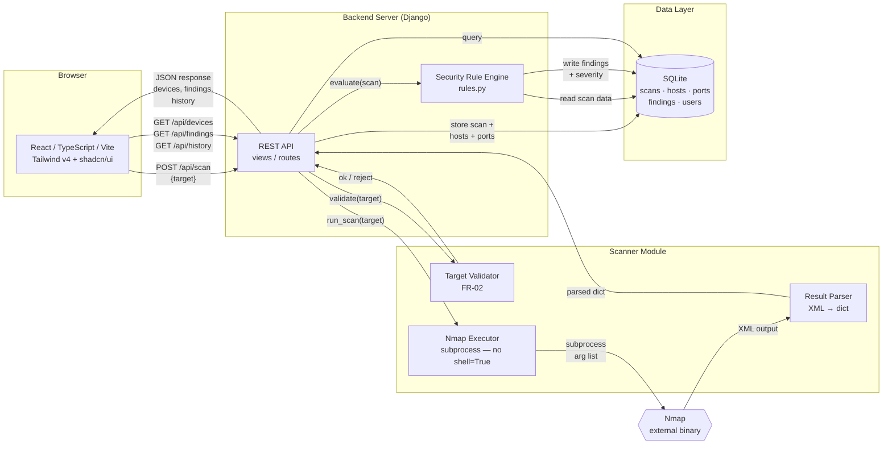

# NetSecure — Architecture

## System Boundaries and Data Flow

The diagram below shows how a scan request moves through the system, from user
action to dashboard display. Each box is a deployable component with a distinct
responsibility. Arrows show the primary data flow direction.

## Component Responsibilities

| Component | Directory | Key Files (planned) | SRS Coverage |
|-----------|-----------|---------------------|--------------|
| **Frontend** | `frontend/` | `src/App.tsx`, pages, components | FR-04, FR-06 (display), NFR-02, NFR-03 |
| **Backend API** | `backend/` | `config/settings.py`, `config/urls.py`, `api/views.py`, `api/urls.py` | FR-01 (invoke), FR-03 (store), FR-05 (warnings) |
| **Scanner** | `scanner/` | `scanner.py`, `validator.py` | FR-01 (Nmap), FR-02 (validation) |
| **Database** | `database/` | `schema.sql`, `models.py`, migrations | FR-03 (persistence), NFR-04 (failure logs) |
| **Rule Engine** | `backend/` | `rules.py` | FR-05 (warnings), FR-06 (severity) |

## Current Repo State

As of initial scaffold:

- **`frontend/`** — Vite + React + TypeScript + Tailwind v4 project initialized.
  Boilerplate `App.tsx` and `main.tsx` present. No application pages yet.
- **`backend/`** — Django 6.1 project initialized (`config/` project package,
  `api/` app). Settings read from environment variables; only `GET /api/health/`
  is routed so far.
- **`scanner/`** — Empty (`.gitkeep`). Scanner module not yet created.
- **`database/`** — Empty (`.gitkeep`). Schema not yet defined.
- **`docs/`** — SRS and Project Plan present. Design doc, roadmap, and this file
  added as part of repo setup.

## Interface Contracts (to be defined in WBS 2.0)

These interfaces connect the components. Exact shapes will be agreed during the
Architecture and Interfaces phase (Sep 16–27).

| Interface | From → To | Format |
|-----------|-----------|--------|
| Scan request | Frontend → Backend | `POST /api/scan` — JSON `{ target: string }` |
| Scan result | Scanner → Backend | Python dict: `{ hosts: [{ ip, hostname, ports: [{ number, protocol, service, state }] }] }` |
| Findings | Rule Engine → Database | Finding rows: `{ scan_id, host_ip, port, service, severity, description }` |
| Dashboard data | Backend → Frontend | JSON — devices, findings, history endpoints |

## Deployment Environment

- **Runtime:** Ubuntu Linux VM (VirtualBox) — NFR-06
- **Database:** SQLite file in `database/` — no external DB server
- **Scanner:** Nmap installed on the host; invoked via subprocess
- **Frontend:** Vite dev server during development; static build for demo
