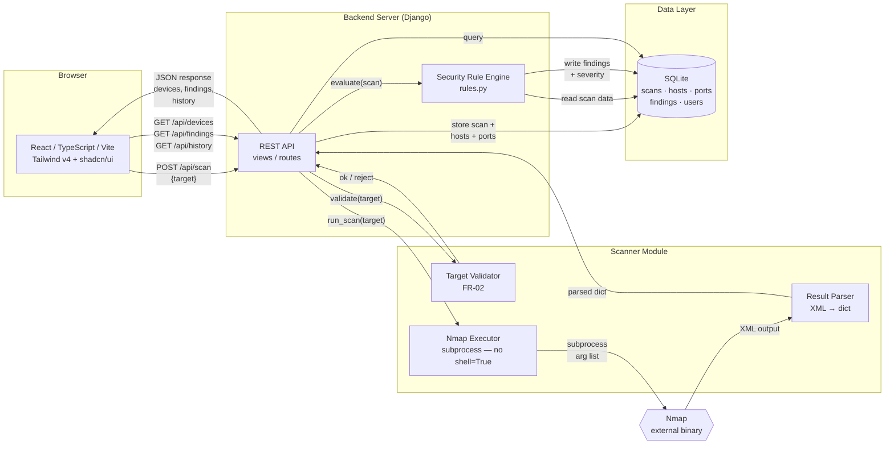

# NetSecure — Architecture

## System Boundaries and Data Flow

The diagram below shows how a scan request moves through the system, from user
action to dashboard display. Each box is a deployable component with a distinct
responsibility. Arrows show the primary data flow direction.



## Component Responsibilities

| Component | Directory | Key Files (planned) | SRS Coverage |
|-----------|-----------|---------------------|--------------|
| **Frontend** | `frontend/` | `src/routes.tsx`, `src/layouts/`, `src/pages/`, `src/components/`, `src/api/client.ts` | FR-04, FR-06 (display), NFR-02, NFR-03 |
| **Backend API** | `backend/` | `config/settings.py`, `config/urls.py`, `api/views.py`, `api/urls.py` | FR-01 (invoke), FR-03 (store), FR-05 (warnings) |
| **Scanner** | `scanner/` | `scanner.py`, `validator.py` | FR-01 (Nmap), FR-02 (validation) |
| **Database** | `database/` | `schema.sql`, `models.py`, migrations | FR-03 (persistence), NFR-04 (failure logs) |
| **Rule Engine** | `backend/` | `rules.py` | FR-05 (warnings), FR-06 (severity) |

## Current Repo State

As of initial scaffold:

- **`frontend/`** — Dashboard shell: sidebar layout with React Router routes for
  New Scan, Devices, Findings, and History (placeholder content). Vite proxies
  `/api` to Django in development; the header shows backend health from
  `GET /api/health/`. Tests run with Vitest + React Testing Library.
- **`backend/`** — Django 6.1 project initialized (`config/` project package,
  `api/` app). Settings read from environment variables; only `GET /api/health/`
  is routed so far. All `/api/` errors return JSON (see API Error Format below).
  Scan-target validation is a fail-closed placeholder until the scanner's
  validator exists.
- **`scanner/`** — Empty (`.gitkeep`). Scanner module not yet created.
- **`database/`** — Empty (`.gitkeep`). Schema not yet defined.
- **`docs/`** — SRS and Project Plan present. Design doc, roadmap, and this file
  added as part of repo setup.

## Interface Contracts (to be defined in WBS 2.0)

These interfaces connect the components. Exact shapes will be agreed during the
Architecture and Interfaces phase (Sep 16–27).

| Interface | From → To | Format |
|-----------|-----------|--------|
| Scan request | Frontend → Backend | `POST /api/scan` — JSON `{ target: string }` |
| Scan result | Scanner → Backend | Python dict: `{ hosts: [{ ip, hostname, ports: [{ number, protocol, service, state }] }] }` |
| Findings | Rule Engine → Database | Finding rows: `{ scan_id, host_ip, port, service, severity, description }` |
| Dashboard data | Backend → Frontend | JSON — devices, findings, history endpoints |
| API errors | Backend → Frontend | JSON — see API Error Format below |

## API Error Format

Every error response under `/api/` uses the same JSON shape, whatever the
cause (bad input, unknown URL, wrong method, CSRF failure, server error):

```json
{ "error": { "code": "validation_error", "message": "\"target\" is required.", "details": { "field": "target" } } }
```

- `code` — stable, machine-readable string; branch on this in the frontend.
- `message` — human-readable text, safe to show the user.
- `details` — optional; for field errors, `field` names the request field.

| Status | `code` | When |
|--------|--------|------|
| 400 | `invalid_json` | Body is not valid JSON, or not a JSON object |
| 400 | `validation_error` | A field is missing, the wrong type, blank, or too long |
| 400 | `invalid_target` | Scanner validator rejected the target (FR-02) — available once the scanner is integrated |
| 400 | `bad_request` | Other malformed request |
| 403 | `forbidden` | Permission denied or CSRF check failed |
| 404 | `not_found` | Unknown URL or missing resource |
| 405 | `method_not_allowed` | Wrong HTTP method (`Allow` header lists valid ones) |
| 413 | `payload_too_large` | Body exceeds Django's upload size limit |
| 415 | `unsupported_media_type` | Body sent without `Content-Type: application/json` |
| 500 | `internal_error` | Unexpected server error (details are logged, never returned) |
| 503 | `target_validation_unavailable` | Scan requested before the scanner's target validator is integrated |

Implemented in `backend/api/errors.py` (format and middleware),
`backend/api/validation.py` (request body checks), and `backend/api/targets.py`
(the single scan-target validation point).

## Deployment Environment

- **Runtime:** Ubuntu Linux VM (VirtualBox) — NFR-06
- **Database:** SQLite file in `database/` — no external DB server
- **Scanner:** Nmap installed on the host; invoked via subprocess
- **Frontend:** Vite dev server during development; static build for demo
